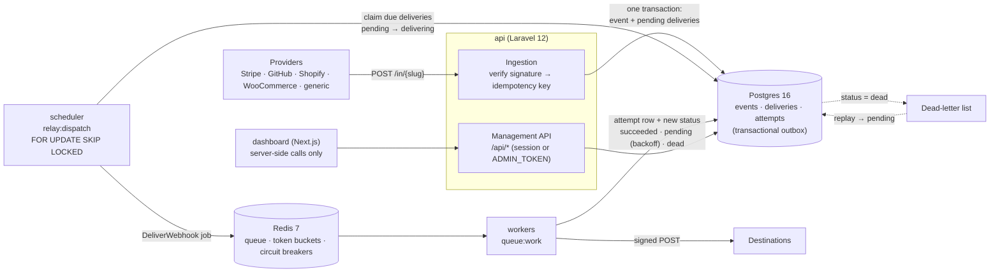

# HookRelay

A self-hostable webhook relay. HookRelay receives webhooks from providers such as Stripe, GitHub, Shopify and WooCommerce. It stores them durably and delivers them to one or more destinations, with retries, a dead-letter queue and replay.

- **Fast, safe ingestion.** Ingestion verifies the signature, dedupes the webhook and writes it to a Postgres outbox in one transaction, then answers `202`. That takes about 20 ms on a laptop.
- **At-least-once delivery.** Retries use exponential backoff with full jitter, and each destination gets its own rate limit and circuit breaker.
- **Dead letters and replay.** Deliveries that use up their attempts land in a dead-letter list, and you can replay them one at a time or in bulk.
- **Dashboard.** You can browse every event, delivery and attempt, down to the raw headers and response bodies.

> Phase 1: the core engine. Multi-tenancy, billing, auth beyond a single admin token and object storage for large bodies are deliberately out of scope. Look for `TODO(...)` notes in the code where they will plug in.

## Quick start

```bash
docker compose up -d      # api :8080, dashboard :3000, mock receiver :4000
curl -X POST localhost:8080/in/demo -H 'Content-Type: application/json' -d '{"hello":"world"}'
```

Then open <http://localhost:3000> and sign in. The event is delivered to the `/ok` receiver straight away. The `/flaky` receiver fails half the time, so its delivery shows retries.

The first `docker compose up` builds the images, which takes a few minutes. On boot the `api` container runs migrations and, in demo mode, creates the demo user and demo data, so `make seed` is optional.

### Demo account

| Email | Password |
|---|---|
| `demo@hookrelay.local` | `hookrelay-demo` |

The login page pre-fills these credentials when `DEMO_MODE=true`, which is the Compose default. The demo user can browse, send test webhooks and replay deliveries. It can create destinations only on the mock receiver, and it can't delete data or change settings. A banner reads "Demo mode, data resets nightly", and a scheduled job restores the demo data at 03:00 UTC.

For full access, create an admin:

```bash
docker compose exec api php artisan relay:admin you@example.com --generate   # prints a random password
```

> **Self-hosting for real? Set `DEMO_MODE=false`.** The demo credentials are public. With demo mode off, the demo user is deleted on boot and can't sign in, and the nightly reset doesn't run.

| Command | What it does |
|---|---|
| `make up` / `make down` | Build and start / stop the stack |
| `make seed` | Create the demo setup (idempotent) |
| `make test` | Run the Pest suite inside the `api` container (against a separate `hookrelay_test` database) and the dashboard's Vitest tests |
| `make audit` | `composer audit` and `npm audit`, failing on high or critical issues |
| `make logs` | Follow the logs of every service |
| `make lint` | Run Pint and ESLint |

> **Before exposing HookRelay anywhere,** copy `.env.example` to `.env`, set `APP_KEY`, `ADMIN_TOKEN`, `RELAY_OUTBOUND_SECRET` and `POSTGRES_PASSWORD`, and decide on `DEMO_MODE`. The compose file ships development defaults so it works from a clean clone. With `APP_ENV=production`, every API container refuses to start while `APP_KEY`, `ADMIN_TOKEN` or `RELAY_OUTBOUND_SECRET` is empty or still a default. See [SECURITY.md](SECURITY.md).

## Architecture



**Services** (`docker-compose.yml`):

| Service | Role |
|---|---|
| `api` | FrankenPHP serving `POST /in/{slug}` and the `/api` management API. Runs migrations on boot. |
| `scheduler` | `php artisan relay:dispatch`: a loop that moves due deliveries from Postgres to Redis every ~2 s. |
| `worker` (×2) | `php artisan queue:work redis`: performs the HTTP deliveries. Scale it with `WORKER_REPLICAS`. |
| `postgres` | Source of truth: the events, deliveries and attempts tables. |
| `redis` | Job queue, per-destination token buckets and circuit-breaker state. |
| `dashboard` | Next.js 16 UI behind a login. It calls the API server-side with the signed-in user's session token, kept in an httpOnly cookie. |
| `cron` | `php artisan schedule:work`: `relay:prune` at 02:30 UTC daily and, in demo mode, the demo reset at 03:00 UTC. |
| `mock-receiver` | A test destination: `/ok` (200), `/fail` (500), `/flaky` (50 % 500), `/timeout` (hangs), or `/any?mode=…&status=…&delay_ms=…`. `GET /_received` shows the last 100 requests. |

### Lifecycle of a webhook

1. **Ingestion** (`POST /in/{slug}`):
   1. Look up the source.
   2. If the source has a `signing_secret`, verify the signature. A bad or missing signature returns `401` and nothing is stored.
   3. Compute the idempotency key.
   4. In **one transaction**, insert the event plus one `pending` delivery per enabled connection.
   5. Return `202 {"event_id"}`.

   A duplicate returns `200` with the original `event_id` and creates nothing. The raw body is stored byte-for-byte. Bodies that aren't valid UTF-8, or that contain NUL bytes, are stored base64-encoded (`body_encoding = base64`) because Postgres `text` can't hold them.
2. **Dispatch.** `relay:dispatch` claims up to 100 due deliveries with `UPDATE … FROM (SELECT … FOR UPDATE SKIP LOCKED LIMIT 100)`, marks them `delivering` and pushes one `DeliverWebhook` job each. Any number of dispatchers can run side by side without double-claiming. Deliveries stuck in `delivering` for more than 5 minutes (a crashed worker or a lost job) go back to `pending` on boot and once a minute after that.
3. **Delivery.** The worker:
   1. Takes a token from the destination's bucket. If none is free, it releases the job for 1 s; that doesn't count as an attempt.
   2. Asks the circuit breaker for permission. If the circuit is open, it reschedules the delivery for when the circuit half-opens; that doesn't count as an attempt either.
   3. POSTs the original body and content type with a timeout of `timeout_ms`.
   4. Records an `attempts` row for every try.
4. **Outcome.**
   - A `2xx` response → `succeeded`.
   - A permanent `4xx`, meaning any 4xx except `408` and `429`, or a target blocked by the SSRF guard → `failed` straight away, with no retries.
   - Anything else, including `5xx`, `408`, `429`, timeouts and connection errors → `attempt_count + 1`. If that's still below `max_attempts`, the delivery goes back to `pending` with `next_attempt_at = now + random(0, min(6h, 30s × 4^(n-1)))` (full jitter). Otherwise → `dead`.
5. **Replay.**
   - `POST /api/deliveries/{id}/replay` resets one delivery to `pending` with a fresh attempt budget. Its earlier attempts stay in `attempts` as history.
   - `POST /api/deliveries/replay` does the same in bulk for every delivery matching `status` (`dead` by default, or `failed`), `destination_id` and a `from`/`to` date range on the delivery's creation time. It returns `202` with a **replay batch** at once. A queued job then works through the matches in chunks of 500 and records `total`, `processed` and `replayed` in `replay_batches`. The dashboard shows a live progress bar.
6. **Retention.** `relay:prune` runs daily at 02:30 UTC from the `cron` service. It deletes events older than `RELAY_RETENTION_DAYS` (default 7), with their deliveries and attempts, in batches of 1,000. It **never** deletes an event that still has an undelivered delivery (`pending`, `delivering`, `failed` or `dead`), and never before its source's dedupe window has passed. It also clears expired sessions and old finished replay batches. Run `php artisan relay:prune --dry-run` to see what it would delete.

Delivery statuses: `pending` → `delivering` → `succeeded` | `pending` (retry) | `failed` | `dead`.

#### Decision: `failed` means "permanent, don't retry"

Phase 1 reserved `failed` without using it. Phase 2 gives it a meaning instead of removing it. Retrying a request the destination has rejected as invalid wastes up to six attempts and several hours, and it hides misconfigurations, such as a wrong URL (`404`) or bad credentials (`401`/`403`), behind a long retry tail. So:

| Outcome | Status | Retried? | Circuit breaker |
|---|---|---|---|
| `2xx` | `succeeded` | — | success |
| `4xx` except `408`/`429` | `failed` | no | success (the destination is up) |
| SSRF guard blocked the address | `failed` | no | unchanged |
| `5xx`, `408`, `429`, timeout, connection error, DNS failure | `pending` → … → `dead` | yes, with backoff | failure |

`failed` and `dead` deliveries both appear in the dashboard's dead-letter view, on separate tabs, and both can be replayed once the cause is fixed.

### Signatures and idempotency keys

| Provider | Signature header | Scheme | Idempotency key |
|---|---|---|---|
| `stripe` | `Stripe-Signature` | `t=…,v1=…`: HMAC-SHA256 hex of `"{t}.{body}"`; `t` must be within 5 minutes | `id` in the JSON body |
| `github` | `X-Hub-Signature-256` | `sha256=` + HMAC-SHA256 hex | `X-GitHub-Delivery` |
| `shopify` | `X-Shopify-Hmac-Sha256` | base64 of the HMAC-SHA256 | `X-Shopify-Webhook-Id` |
| `woocommerce` | `X-WC-Webhook-Signature` | base64 of the HMAC-SHA256 | `X-WC-Webhook-Delivery-ID` |
| `generic` | `X-Webhook-Signature` | HMAC-SHA256 hex, with or without a `sha256=` prefix | `Idempotency-Key` header if present |

Signature checks only run when the source has a `signing_secret`. All comparisons use `hash_equals`. When there's no provider id, the key is `sha256(raw body)`. Keys are unique per source within `dedupe_window_seconds` (default 24 h). After the window, the same key is accepted again as a new event.

### Safety limits

- **SSRF guard.** Destination URLs may not point at private, loopback, link-local or cloud-metadata, CGNAT, multicast or IPv6 unique-local addresses, either directly or through DNS. The URL is checked when a destination is saved and again before every delivery. At delivery, every address the host resolves to must pass, and the request is then **pinned to the checked IP**, so a DNS-rebinding answer can't redirect it. Redirects are never followed. Internal targets need an explicit opt-in through `RELAY_SSRF_ALLOWLIST`: hostnames, `*.suffix` wildcards, IPs or CIDR ranges. Compose lists `mock-receiver` by default.
- **Ingestion limits.** Each source can have its own `rate_limit_rps`, or falls back to `RELAY_INGEST_DEFAULT_RPS`. Excess requests get `429` with `Retry-After: 1`, checked before the signature so floods stay cheap. Bodies over `RELAY_MAX_BODY_BYTES` (default 2 MB) get `413`, decided from `Content-Length` before the body is read.

### Outbound requests

Each delivery is a `POST` of the original body, sent with the original `Content-Type`, plus:

```
X-HookRelay-Event-Id:    <event uuid>
X-HookRelay-Delivery-Id: <delivery uuid>
X-HookRelay-Attempt:     <1-based attempt number within the current replay cycle>
X-HookRelay-Signature:   sha256=<hex HMAC-SHA256 of the body using RELAY_OUTBOUND_SECRET>
```

A destination's `auth_header` is stored encrypted. A value like `Bearer xyz` is sent as `Authorization`, and a value like `X-Api-Key: xyz` is sent as that header. HookRelay doesn't follow redirects; a `3xx` counts as a failure.

To verify a delivery on the receiving side:

```php
$expected = 'sha256='.hash_hmac('sha256', file_get_contents('php://input'), $outboundSecret);
hash_equals($expected, $_SERVER['HTTP_X_HOOKRELAY_SIGNATURE']);
```

## Operations

### Health checks

| Endpoint / check | Meaning |
|---|---|
| `GET /health` (API) | Liveness: the process answers. Has no dependencies, so a database blip doesn't restart the API. |
| `GET /ready` (API) | Readiness: Postgres, the schema and Redis are all OK, otherwise `503` with per-check details. Used by the `api` healthcheck. |
| `php artisan relay:health --role=worker\|dispatcher\|cron` | For processes without HTTP. Postgres and Redis must be reachable, and the process's loop **heartbeat** in Redis must be fresh, so a hung worker shows as unhealthy, not just a dead one. |
| `GET /healthz` (dashboard), `GET /health` (mock receiver) | Liveness |

Every Compose service has a healthcheck, and `docker compose ps` shows them all `healthy`.

### Metrics

`GET /metrics` serves the Prometheus text format. Set `RELAY_METRICS_TOKEN` to require `Authorization: Bearer …`; otherwise restrict it at your proxy or network.

| Metric | Type | Labels |
|---|---|---|
| `hookrelay_events_received_total` | counter | `source` |
| `hookrelay_deliveries` | gauge | `status` |
| `hookrelay_outbox_due` | gauge | — (pending deliveries due, waiting for the dispatcher) |
| `hookrelay_delivery_attempts_total` | counter | `outcome` = success, retry, failed, dead |
| `hookrelay_attempt_duration_seconds` | histogram | buckets from 50 ms to 30 s |
| `hookrelay_queue_depth` | gauge | `queue` (Redis: ready + delayed + reserved) |
| `hookrelay_circuit_breaker_state` | gauge | `destination_id`, `destination` (0 closed, 1 open, 2 half-open) |
| `hookrelay_alerts_total` | counter | `kind`, `result` = sent or suppressed |

Counters and the histogram live in Redis, so every API and worker container adds to the same series. Gauges are read at scrape time.

### Logs

All PHP services log **one JSON object per line** to stderr (Monolog's `JsonFormatter`). Lines written while handling a webhook or delivery carry `event_id`, `delivery_id`, `destination_id` and `source` under `extra`, through Laravel's `Context`. Key messages are `webhook.received`, `webhook.duplicate`, `delivery.succeeded`, `delivery.retry_scheduled`, `delivery.failed`, `delivery.dead`, `circuit.opened` and `alert.*`.

```bash
docker compose logs worker --no-log-prefix | jq 'select(.extra.event_id == "<event uuid>")'
```

### Alerts

When a delivery goes **dead** or a destination's **circuit breaker opens**, HookRelay posts to a Slack incoming webhook (`RELAY_ALERT_SLACK_WEBHOOK_URL`) and/or emails `RELAY_ALERT_EMAIL`, using Laravel's `MAIL_*` settings. Alerts are rate limited per destination and kind: one per `RELAY_ALERT_COOLDOWN_SECONDS`, default 15 minutes. An outage therefore produces one message, not one per webhook. Suppressed alerts are counted in `hookrelay_alerts_total`.

## Delivery guarantees and their limits

**At-least-once delivery, plus dedupe at ingestion.**

- **No webhook is lost once it gets a `202`.** The event and its deliveries are committed together before the response goes out. If Redis is down or a worker crashes, the deliveries stay in Postgres and are re-dispatched: a crashed attempt is recovered after 5 minutes.
- **Duplicates from providers are dropped.** Provider retries carry the same event id, or the same body, so they map to the same idempotency key and return `200` without creating new deliveries.

The limits:

- **Destinations can receive a webhook more than once.** For example, a worker can crash after the destination answered `2xx` but before the status was saved. A slow attempt can also outlive the 5-minute recovery window. **Receivers should dedupe on `X-HookRelay-Event-Id`.**
- **There is no ordering guarantee.** Retries, jitter and parallel workers mean events can arrive out of order.
- **The rate limit is approximate.** Rate-limited jobs wait in the queue, and a burst can exceed `rate_limit_rps` for a moment while buckets refill.
- **The circuit breaker is per destination, not per URL path or host.** While a circuit is open, deliveries are postponed, not failed, so a long outage uses calendar time, not attempts.
- **Dedupe has edge cases.** The idempotency key is per source. For the body-hash fallback, two legitimately identical payloads within the dedupe window count as one event.
- **Bodies are capped.** The API accepts bodies up to `RELAY_MAX_BODY_BYTES` (default 2 MB; at most 10 MB, PHP's `post_max_size`), and everything lives in Postgres. *TODO(object-storage): spill large bodies to S3-compatible storage.*

## Management API

All `/api/*` routes need a bearer token: either the static `ADMIN_TOKEN` (for scripts; acts as an admin) or a session token from `POST /api/auth/login` (what the dashboard uses; acts as that user). See [docs/api.md](docs/api.md) for every endpoint and response shape.

```bash
export HR=http://localhost:8080 AUTH="Authorization: Bearer dev-admin-token" JSON="Content-Type: application/json"

# Create a source and a destination, then connect them
curl -s -X POST $HR/api/sources -H "$AUTH" -H "$JSON" \
  -d '{"name":"GitHub","slug":"github","provider":"github","signing_secret":"s3cret"}'
curl -s -X POST $HR/api/destinations -H "$AUTH" -H "$JSON" \
  -d '{"name":"My app","url":"https://example.com/webhooks","auth_header":"Bearer abc","max_attempts":6,"rate_limit_rps":10}'
curl -s -X POST $HR/api/connections -H "$AUTH" -H "$JSON" \
  -d '{"source_id":"<source uuid>","destination_id":"<destination uuid>"}'

# Send a signed GitHub-style webhook
BODY='{"action":"opened"}'
SIG=$(printf '%s' "$BODY" | openssl dgst -sha256 -hmac s3cret -r | cut -d' ' -f1)
curl -s -X POST $HR/in/github -H "$JSON" -H "X-GitHub-Delivery: 123" -H "X-Hub-Signature-256: sha256=$SIG" -d "$BODY"

# Send a signed Stripe webhook to the seeded stripe-test source
T=$(date +%s); BODY='{"id":"evt_1","type":"invoice.paid"}'
SIG=$(printf '%s' "$T.$BODY" | openssl dgst -sha256 -hmac whsec_test_hookrelay_demo -r | cut -d' ' -f1)
curl -s -X POST $HR/in/stripe-test -H "$JSON" -H "Stripe-Signature: t=$T,v1=$SIG" -d "$BODY"

# Inspect
curl -s "$HR/api/events?per_page=5" -H "$AUTH"
curl -s "$HR/api/events/<event uuid>" -H "$AUTH"            # headers, body, deliveries, attempts
curl -s "$HR/api/deliveries?status=dead" -H "$AUTH"
curl -s "$HR/api/stats" -H "$AUTH"                          # 24 h counts by status, p50/p95 latency

# Replay
curl -s -X POST "$HR/api/deliveries/<delivery uuid>/replay" -H "$AUTH"
curl -s -X POST "$HR/api/deliveries/replay" -H "$AUTH" -H "$JSON" \
  -d '{"status":"dead","destination_id":"<destination uuid>","from":"2026-10-01","to":"2026-10-15"}'
# → 202 {"data":{"id":"<batch uuid>","status":"queued",...}}; poll for progress:
curl -s "$HR/api/replay-batches/<batch uuid>" -H "$AUTH"
```

## Configuration

Set these in the root `.env`; Compose reads them. Defaults are in brackets.

| Variable | Purpose |
|---|---|
| `APP_KEY` | Laravel encryption key, used for `signing_secret` and `auth_header` at rest. Generate one with `docker compose run --rm api php artisan key:generate --show`. |
| `ADMIN_TOKEN` | Static admin bearer token for `/api/*` scripts and automation. The dashboard doesn't use it. [`dev-admin-token`] |
| `DEMO_MODE` | Public demo: demo user, banner, nightly reset. **Set `false` for real installs.** [`true`] |
| `DEMO_DESTINATION_HOSTS` | Hosts the demo user may create destinations on. [`mock-receiver`] |
| `RELAY_SESSION_MINUTES` | Dashboard session lifetime. [720] |
| `RELAY_RETENTION_DAYS` | `relay:prune` keeps events this long, and never deletes undelivered ones. [7] |
| `RELAY_SSRF_ALLOWLIST` | Internal destinations to allow (hostnames, `*.suffix`, IPs, CIDRs). [`mock-receiver`] |
| `RELAY_MAX_BODY_BYTES` | Max webhook body; larger requests get `413`. [2097152] |
| `RELAY_INGEST_DEFAULT_RPS` | Per-source ingestion rate limit when the source sets none; `429` beyond it. [unlimited] |
| `RELAY_OUTBOUND_SECRET` | HMAC secret for `X-HookRelay-Signature`. |
| `RELAY_BACKOFF_BASE_SECONDS` / `_FACTOR` / `_CAP_SECONDS` | Retry schedule. [30 / 4 / 21600] Set the base to `2` for quick demos of retries and dead letters. |
| `RELAY_DISPATCH_BATCH`, `RELAY_DISPATCH_INTERVAL` | Dispatcher batch size and idle sleep. [100, 2 s] |
| `RELAY_STUCK_AFTER_SECONDS` | How long a delivery may sit in `delivering` before it is recovered. [300] |
| `RELAY_CIRCUIT_THRESHOLD`, `RELAY_CIRCUIT_OPEN_SECONDS` | Circuit breaker. [5 failures, 60 s] |
| `WORKER_REPLICAS` | Number of delivery workers. [2] |

## Development

```
api/              Laravel 12 app (PHP 8.3)
  app/Services/Ingest/     SignatureVerifier, IdempotencyKey, Ingestor (outbox)
  app/Services/Delivery/   Dispatcher, Deliverer, Backoff, TokenBucket, CircuitBreaker, Replayer
  app/Jobs/DeliverWebhook  thin queue wrapper around Deliverer
  tests/                   Pest: unit (signatures, backoff) + feature (Postgres + Redis)
dashboard/        Next.js 16 App Router (React 19) + Tailwind 4, Vitest
mock-receiver/    zero-dependency Node test destination
docs/api.md       management API contract
```

The API runs on Laravel 12, and `composer audit` reports no security advisories, with no ignores configured.

The tests run against real Postgres and Redis, because `SKIP LOCKED`, the Lua token bucket and the circuit breaker need real backends. They use the `hookrelay_test` database and Redis DB 14. `tests/TestCase.php` refuses to run against any database whose name doesn't end in `_test`.

CI (`.github/workflows/ci.yml`) runs `composer audit` and `npm audit --audit-level=high`, then Pest against Postgres and Redis service containers, along with Pint, ESLint, `tsc`, Vitest and `next build`. It also builds every Docker image. Dependabot (`.github/dependabot.yml`) opens weekly update PRs for Composer, npm, Docker base images and GitHub Actions.

The dashboard lints with ESLint 9 using typescript-eslint, react, react-hooks and jsx-a11y directly, not `eslint-config-next`. Every release of Next's ESLint plugin pins `fast-glob` → `micromatch` → `braces`, which has an advisory with no fixed version (GHSA-vfj7-8cjw-p6xm), so it can't pass `npm audit`. The trade-off is losing the `@next/next/*` rules.

### Known gaps / roadmap

- **Auth is deliberately simple:** admin and demo roles, with no per-user permissions, password reset or SSO. *TODO(auth)*
- Multi-tenancy, billing and a WordPress plugin are out of scope for Phase 1. *TODO(multi-tenancy)*

## License

[MIT](LICENSE)
